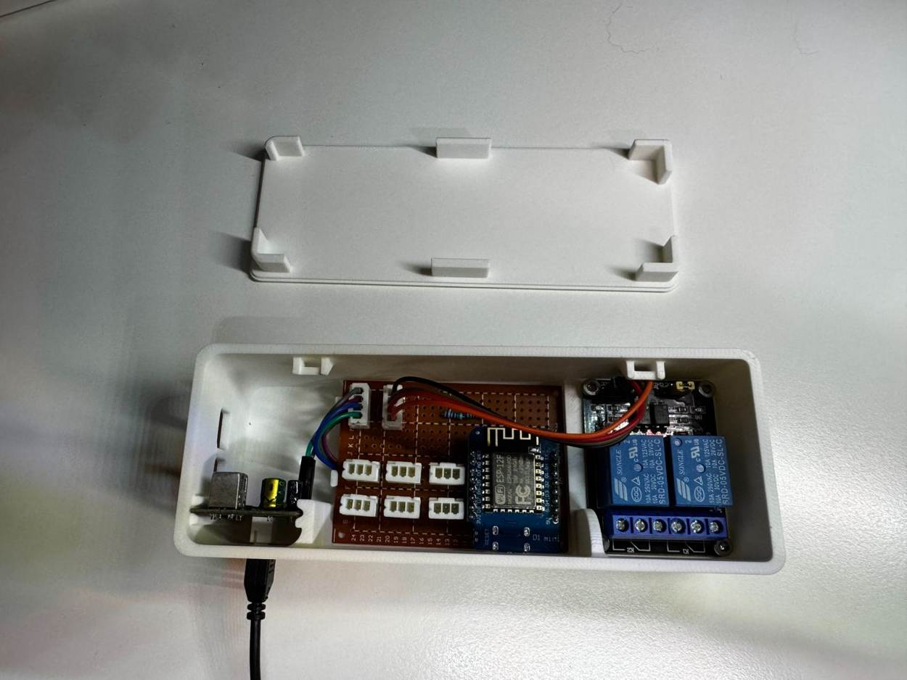
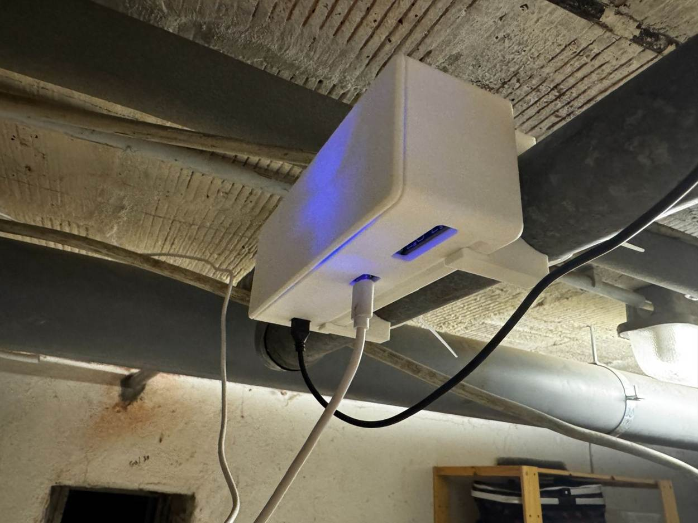
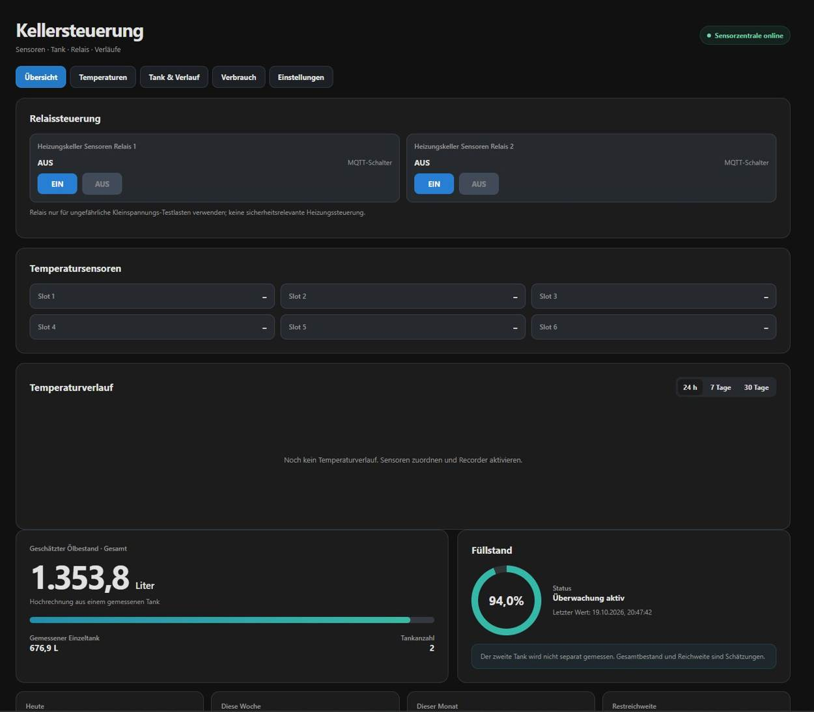

# Keller Sensorzentrale

**ESP8266 / Wemos D1 mini · Tankfüllstand · 6 DS18B20-Slots · 2 Relais · MQTT & Home Assistant**

**Softwarestand:** Firmware v1.9.6 · HA-Pakete v2.1.0 · **neues natives Lovelace-Dashboard v1.0.2** · bisheriges Seitenpanel v2.4.0 · Lovelace-Karte v2.1.1 ([Installationshinweise bei alter Heizölmonitor-Karte](docs/home-assistant/INSTALLATION.md#lovelace-karte-alte-anzeige-oder-falscher-gesamtbestand)).

Eine modulare Sensorzentrale für den Heizungskeller: Das kleine Board sammelt Messwerte und stellt sie per MQTT bereit. Home Assistant übernimmt die Langzeitverläufe, die 5-Minuten-Glättung und die (optional aktivierte) Heizöl-Verbrauchsauswertung.

> **Projektstatus: erprobter Prototyp, kein zertifiziertes Fertigprodukt.** Die Wemos-Firmware v1.9.6 und das Home-Assistant-Paket v2.1.0 wurden aus dem tatsächlich verwendeten Entwicklungsstand übernommen. Es gibt keinen vollständigen reproduzierbaren Hardware-, Kompilier- oder HA-Integrationstest für diesen GitHub-Export. Beim ersten Nachbau Pins und Spannungen messen.

## Neues Lovelace-Dashboard (empfohlen)

**[→ Kellersteuerung_Lovelace.yaml](home-assistant/Kellersteuerung_Lovelace.yaml)** · **[→ Installationsanleitung](docs/home-assistant/LOVELACE_DASHBOARD.md)**

Die frühere Eigenentwicklung des Seitenpanels ist für neue Installationen **nicht erforderlich**. Das native Dashboard nutzt ausschließlich Home-Assistant-Karten und umfasst **7 Ansichten**: Übersicht, Heizkreis, Heiztakte, Temperaturen, Öltank, Verbrauch und System. In der Heizkreis-Ansicht steuert ein integrierter **Datumswähler** die Temperatur- und Spreizungs-Statistikgrafiken; eine Verknüpfung zur HA-Historie zeigt detaillierte Messpunkte. Bisherige Panels/Karten bleiben zur Kompatibilität im Projekt und können parallel betrieben werden.

## Aktueller Entwicklungsstand

**[→ PROJECT_STATUS.md – getesteter Stand, GPIO-Belegung, offene Aufgaben und Arbeitsablauf](PROJECT_STATUS.md)**

Die GitHub-Dateien sind die gemeinsame Codebasis für zukünftige Weiterentwicklung. Der zuletzt getestete Gerätestand und bekannte Einschränkungen stehen in der Statusdatei, nicht in alten Chat-ZIPs.

## Projektbilder – Gehäuse, Montage und Dashboard

| Gehäuse mit Elektronik | Fertig montiert | Home Assistant |
|:---:|:---:|:---:|
| [](docs/galerie/README.md) | [](docs/galerie/README.md) | [](docs/galerie/README.md) |

**[→ 3D-Druck-Gehäuse auf MakerWorld](https://makerworld.com/en/models/3464324-wemos-d1-gehause-fur-ds18b20-und-relais#profileId-3953596)** · **[→ Vollständige Bildergalerie](docs/galerie/README.md)** · **[→ Gehäusedokumentation](enclosure/README.md)** · Die Modelldateien und das Druckprofil werden über MakerWorld angeboten, nicht im GitHub-Repository.


### Tagesweise Heizkreisgrafik (Panel v2.4.0)

Im Reiter **Heizung & Takte** wird zunächst nur der heutige Tagesverlauf gezeigt. Ein Klick öffnet eine große Detailansicht zum Wechseln zwischen Tagen und 6-Stunden-Fenstern sowie zum Ausblenden einzelner Kurven. Die Historie stammt weiterhin aus dem HA-Recorder; Tank- und Ölverbrauchsgrafiken sind unverändert.

### Optionale Heiztakt-Auswertung

Das [HA-Package `keller_heiztakte.yaml`](home-assistant/packages/keller_heiztakte.yaml) zählt **aus Temperaturdaten abgeleitete Aktivphasen**. Der eigenständige Reiter **Heizung & Takte** im Panel v2.3.0 zeigt Starts, Aktiv-/Pausenzeit, Mittelwerte, Extremwerte und markierte Phasen. Ein echter Brennerkontakt wird damit **nicht** ersetzt. [Einrichtung und Grenzen](docs/home-assistant/HEIZTAKTE.md). Das Package v1.0.1 ist zunächst deaktiviert und muss nach HA-Neustart gezielt aktiviert werden.

## Funktionen

- **Ultraschall-Füllstand:** automatischer Impulsmodus des verwendeten SR04M-2-Setups, Datenleitung an D6 (ECHO/TX), kurzer Median aus sieben Pulsen
- **Füllstandstabelle:** bis zu 16 Höhen-/Liter-Werte, im Wemos dauerhaft gespeichert; mehrere gleichartige Tanks hochrechenbar
- **Temperatur:** sechs logische DS18B20-Slots an drei 1-Wire-Bussen; Zuordnung anhand Sensor-ROM-Adresse (jeweils zwei Buchsen pro Bus)
- **Relais:** zwei digitale Ausgänge D7/D0 mit lokalem Test, optionaler MQTT-Steuerfreigabe und OFF-Vorgabe beim Start
- **Home Assistant:** MQTT Discovery, sechs Slots, Relais-Entitäten, Dashboard-Karte und Seitenpanel „Kellersteuerung“ (v2.3.0: eigener Reiter Heizung & Takte mit Heizkreisdiagramm, markierten Aktivphasen und optionalem Taktstatistik-Package; beliebige Zuordnung für die Heizkreis-Kurven)
- **HA-Pakete:** 5-Minuten-Glättung, rechnerischer Gesamtbestand, Tankfüllstand und optionale Verbrauchs-/Nachtank-Auswertung
- **Wartung:** lokales Web-Setup, Status/Diagnose, WLAN, MQTT, OTA/Firmware-Update, frei wählbarer Anzeigename

## Hardware auf einen Blick

| Anschluss | GPIO | Funktion |
| --- | --- | --- |
| Slot 1 & 2 | D1 / GPIO5 | 1-Wire-Temperatursensoren, gemeinsamer Datenbus |
| Slot 3 & 4 | D2 / GPIO4 | 1-Wire-Temperatursensoren, gemeinsamer Datenbus |
| Slot 5 & 6 | D5 / GPIO14 | 1-Wire-Temperatursensoren, gemeinsamer Datenbus |
| Tank ECHO/TX | D6 / GPIO12 | nur mit geeigneter 3,3-V-Pegelanpassung |
| Relais 1 / 2 | D7 / GPIO13, D0 / GPIO16 | aktive LOW-Logik voreingestellt |

**Jeder DS18B20-Bus braucht genau einen Pull-up nach 3,3 V.** Jede 3-Pin-Buchse hat 3V3, DATA, GND; die Kontaktrichtung ist vor dem Einstecken am eigenen Aufbau zu prüfen. 5 V liegen ausschließlich an den getrennten 4-Pin-Anschlüssen an, *nicht* an den Temperatursteckern.

**[→ Bebilderte Bau- und Verdrahtungsanleitung](docs/hardware/BAUANLEITUNG.md)** · **[→ Elektrischer Anschlussplan](docs/hardware/ANSCHLUSSPLAN.md)** · **[→ SVG-Schaltbild](docs/hardware/anschlussplan.svg)** · **[→ Home Assistant installieren](docs/home-assistant/INSTALLATION.md)**

## Software installieren

1. Arduino IDE mit ESP8266-Boardpaket verwenden. Firmware: [`firmware/KellerSensorzentrale/KellerSensorzentrale.ino`](firmware/KellerSensorzentrale/KellerSensorzentrale.ino).
2. Bibliotheken **WiFiManager**, **PubSubClient**, **OneWire**, **DallasTemperature** installieren. Die ESP8266-Boardbibliotheken sind ebenfalls erforderlich.
3. Im Sketch ganz oben die **drei `#BITTE_AENDERN`-Platzhalter** (`SETUP_AP_PASSWORT`, `WEB_BENUTZER`, `ADMIN_PASSWORT`) durch eigene Werte ersetzen. Das AP-Passwort muss für WPA2 mindestens acht Zeichen lang sein. Die anderen Passwörter haben im Sketch keine künstliche Mindestlänge.
4. Board „LOLIN(WEMOS) D1 R2 & mini“ auswählen, kompilieren, über USB hochladen. Serielle Diagnose: **115200 Baud** (einzelne Boot-Meldungen mit 74880 Baud sind normal).
5. WLAN-Portal des ESP aufrufen, WLAN konfigurieren, danach lokale Weboberfläche nutzen. MQTT-Broker und (optional) Relais-MQTT-Freigabe einrichten.
6. Home Assistant mit dem [`home-assistant/`](home-assistant/) Paket konfigurieren. **Die Tankkennlinie wird zunächst weiter im ESP gespeichert**; in HA laufen nur zeitbasierte Filter und Statistik.

## Home Assistant

Die vorhandenen Pfade bleiben aus Kompatibilitätsgründen erhalten: `/local/heizoel-monitor-card.js` und Panel `/heizoel-monitor`. Der sichtbare Titel lautet **Kellersteuerung**. Wie bei älteren HA-Installationen können Entity-IDs vom MQTT-Gerätenamen abhängen. In diesem Export wurde die bestätigte Quellschreibweise `sensor.heizungskeller_sensoren_abstand_geglattet` verwendet.

Das Verbrauchspaket ist **standardmäßig deaktiviert**, bis Tankkalibrierung und beide mechanischen Tankuhren plausibel sind. Aktivierung erst über `input_boolean.keller_verbrauch_aktiv` nach Prüfung.

## Gehäuse und MakerWorld

Das 3D-gedruckte Gehäuse ist bereits [auf MakerWorld veröffentlicht](https://makerworld.com/en/models/3464324-wemos-d1-gehause-fur-ds18b20-und-relais#profileId-3953596). Die 3MF-/STL-Dateien und Druckprofile werden dort bereitgestellt; GitHub enthält [Gehäusedokumentation und Fotos](enclosure/README.md).

## Sicherheit

- **Nur Niederspannungs-Prototyp.** Keine Netzspannung an den gezeigten Anschlussklemmen oder dem Relaismodul verdrahten; kein Einsatz zur sicherheitsrelevanten Heizungssteuerung.
- **Kein Nachweis zur Verwendung in explosionsgefährdeten Bereichen oder in Heizöltanks.** Sensorinstallation nur gemäß Zulassung, Herstellerangaben und örtlichen Vorschriften. Die gezeigte Elektronik ist kein zugelassenes Messsystem für Gefahrstoff-Umgebungen.
- ESP8266-GPIOs sind **nicht 5-V-tolerant**. Für ECHO/TX eines 5-V-Sensors wird eine passende Pegelanpassung benötigt. Die drei 5-kΩ-Widerstände aus dem Prototyp liefern rechnerisch etwa 3,33 V bei exakt 5,0 V; diese Variante wird **nicht als allgemeine sichere Nachbauempfehlung** veröffentlicht.
- Nicht ins Internet port-forwarden; Zugangsdaten nie einchecken. Vor Öffnen der Platine Spannungsversorgung trennen.

## Projektstruktur

```text
firmware/KellerSensorzentrale/         ESP8266-Arduino-Sketch
home-assistant/packages/               Glättung, Berechnung, Verbrauch
home-assistant/www/                    Lovelace Custom Card (alter Dateiname)
home-assistant/custom_components/      Seitenpanel (alter Integrationsname)
docs/hardware/                         Bauanleitung, Schaltplan, Fotos
docs/home-assistant/                   Einrichtung, Fehlerdiagnose
enclosure/                             MakerWorld/3D-Druck-Vorbereitung
.github/                               Issue- und Pull-Request-Vorlagen
```

## Mitarbeit & Lizenz

Fehler, Ergänzungen und neue Sensortypen gerne über Issues oder Pull Requests. Siehe [CONTRIBUTING.md](CONTRIBUTING.md). Code und Dokumentation sind für diese Veröffentlichung unter der **[MIT-Lizenz](LICENSE)** vorbereitet. Das spätere Gehäuse auf MakerWorld kann separat lizenziert werden. Bitte vor Veröffentlichung die Rechte an Platinenfotos und übernommenen Dateien verifizieren; siehe [Lizenzhinweise](LIZENZ-ENTSCHEIDUNG.md).

[English project overview](README.en.md) · [Changelog](CHANGELOG.md) · [Bekannte Einschränkungen](docs/STATUS.md)

## Öffentlich auf GitHub veröffentlichen

1. GitHub → **New repository** → `Keller-Sensorzentrale` → **Public**. README, .gitignore und Lizenz **nicht** automatisch erzeugen lassen (sind vorhanden).
2. Dieses ZIP lokal entpacken. Mit [GitHub Desktop](https://desktop.github.com/) den entpackten Ordner als lokales Repository hinzufügen, initialen Commit erstellen und **Publish repository** mit Sichtbarkeit **Public** wählen. Alternativ die Befehle aus [GITHUB-VEROEFFENTLICHEN.md](GITHUB-VEROEFFENTLICHEN.md) verwenden.
3. Den neuen Repository-Link im MakerWorld-Modell und später den MakerWorld-Link in `enclosure/README.md` ergänzen.
4. Veröffentlichung erst nach Code-/Bildrechteprüfung und einem erfolgreichen ESP8266-Kompiliertest.