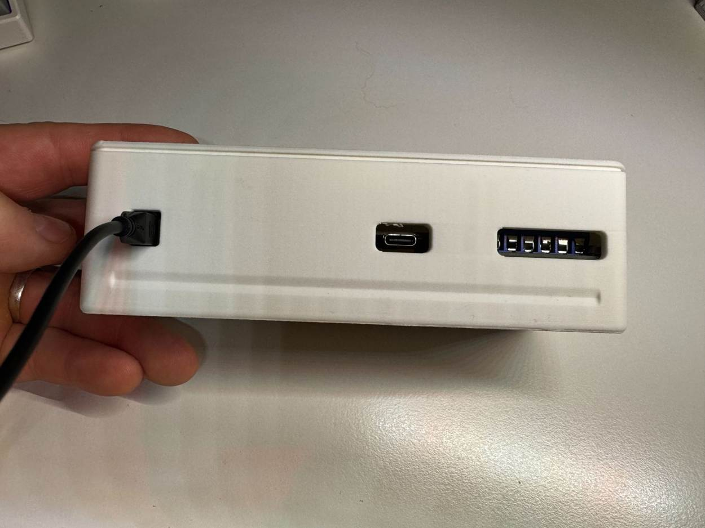
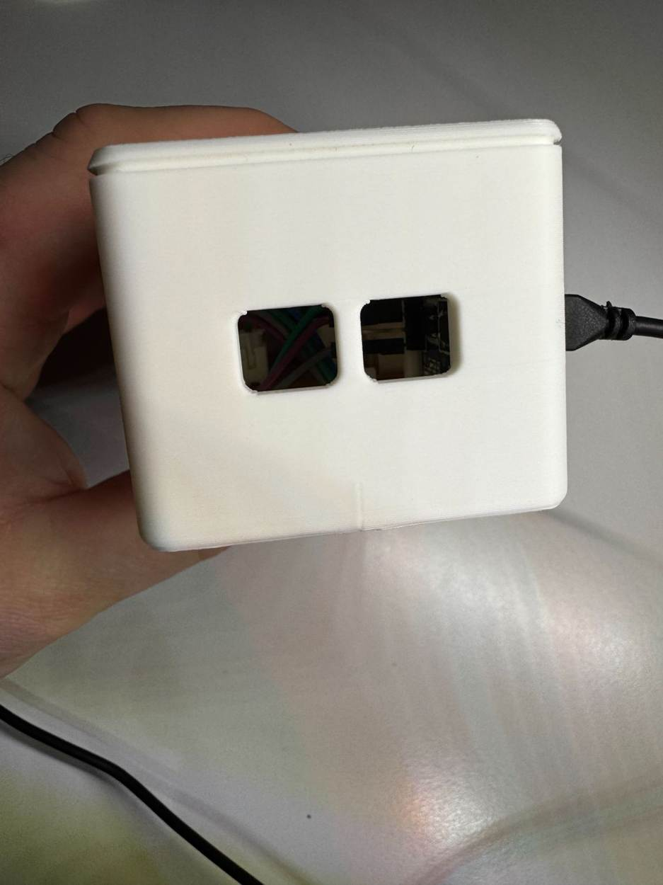
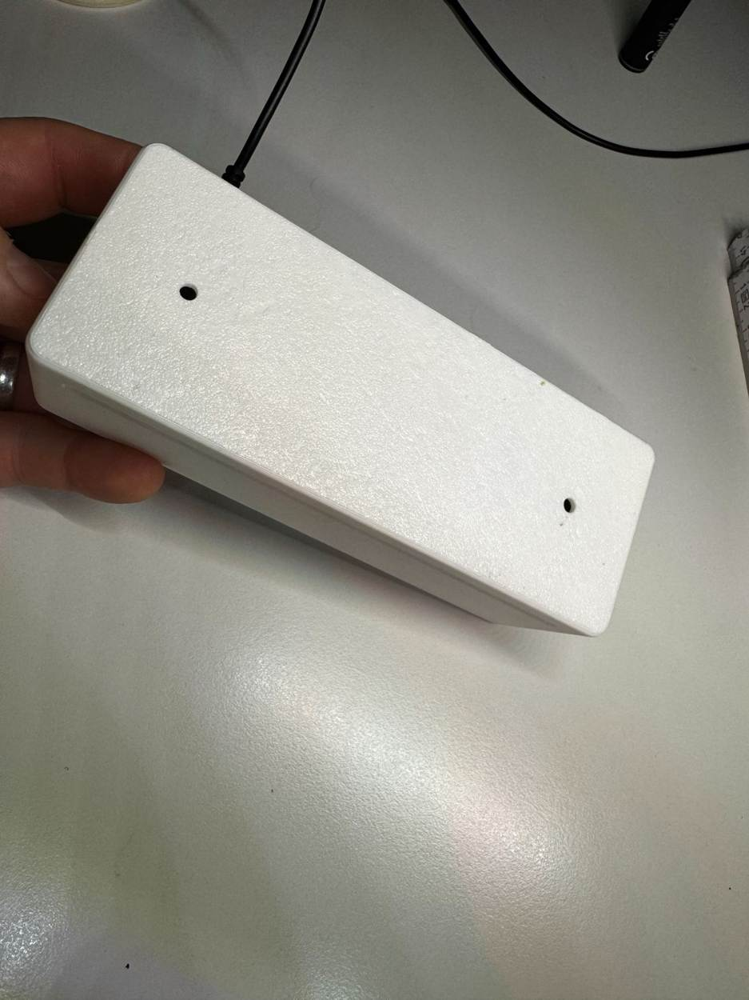
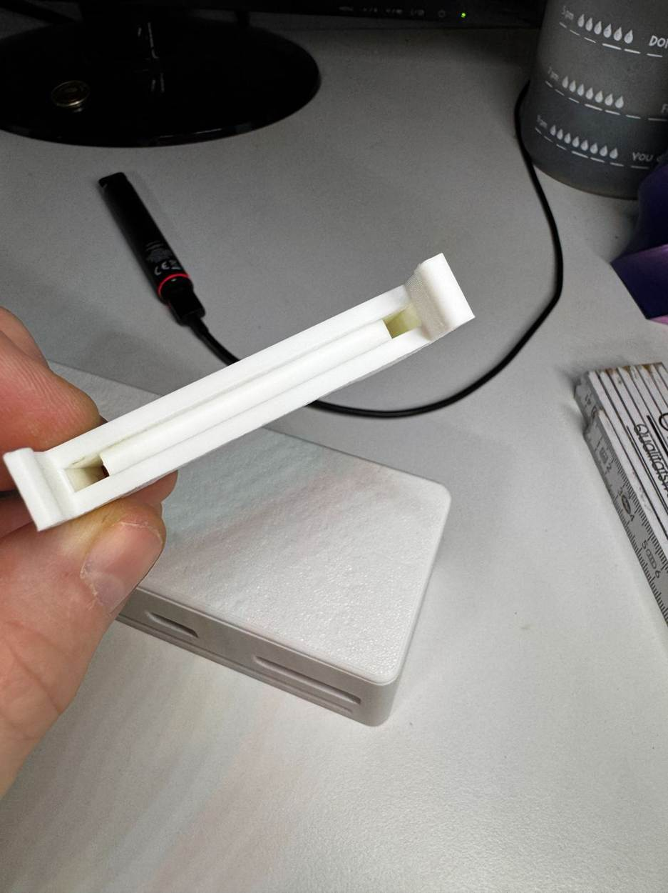
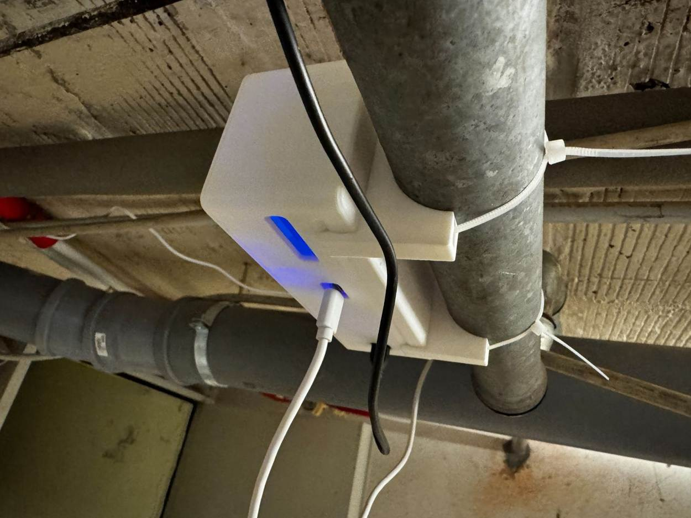
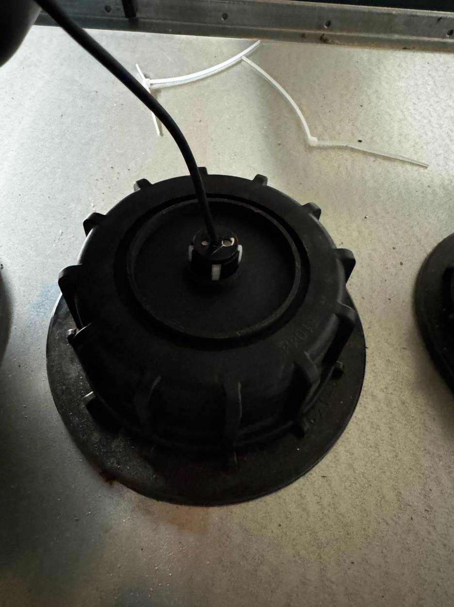
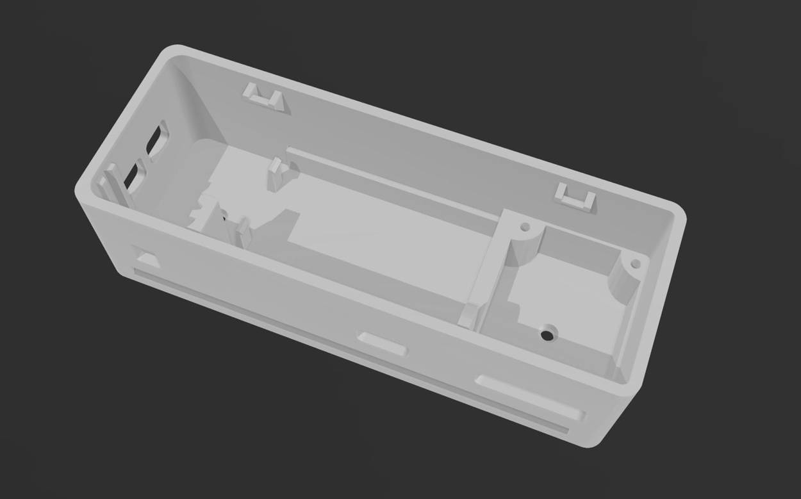
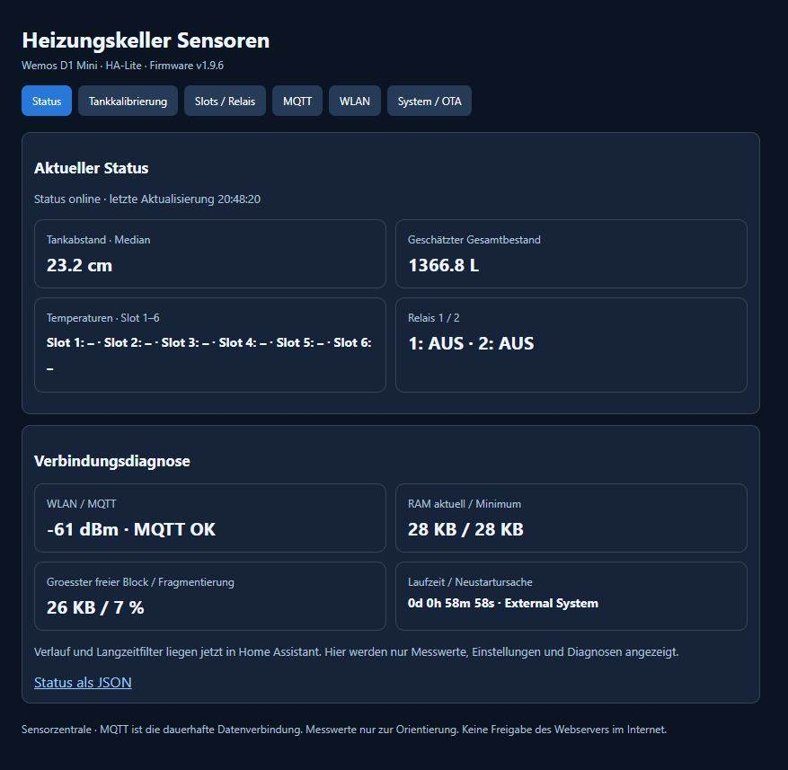

# Projektgalerie – Keller Sensorzentrale

Fotos des aufgebauten Prototyps und Screenshots der beiden Oberflächen. Die Bilder zeigen **eine individuelle Lochrasterplatine**: Maße und Steckerlagen können bei Nachbauten abweichen.

## Gehäuse und Elektronik

*Innenaufbau des Prototyps mit abgenommener Abdeckung.*

*Zugängliche Anschlussseite des 3D-gedruckten Gehäuses.*

*Seitliche Kabelöffnungen.*

*Geschlossener Deckel mit Befestigungspunkten.*

## Montage und CAD

*Einfacher gedruckter Halter des Prototyps.*

*Individuelle Rohrmontage, hier mit Kabelbindern.*

*Fertig montierter Aufbau im Keller.*

*Der vorhandene Tankaufbau: **kein** universeller Montageplan und keine Aussage über Tankabdichtung oder Zulassung.*

*CAD-Ansicht mit Haltestrukturen. [3D-Druck-Modell auf MakerWorld](https://makerworld.com/en/models/3464324-wemos-d1-gehause-fur-ds18b20-und-relais#profileId-3953596).*

## Software

*Home Assistant: Relais, Sensor-Slots, Tankfüllstand und Langzeitverläufe.*

*Lokale kompakte Status- und Konfigurationsoberfläche des Wemos.*

## Nutzungsrechte und Privatsphäre

Die öffentlich bereitgestellten Fotos sind zur Veranschaulichung des Projekts gedacht. Die MIT-Lizenz des Quellcodes ist **keine pauschale Fotolizenz**. Bitte frage vor einer Weiterverwendung oder dem Nachdruck der Bilder nach. Beim Export wurden Bildmetadaten entfernt.

Das gezeigte Gehäuse ist ein 3D-Druck-Prototyp und nicht als zertifizierte Schutzeinrichtung oder für netzspannungsführende beziehungsweise explosionsgefährdete Installationen geprüft.
