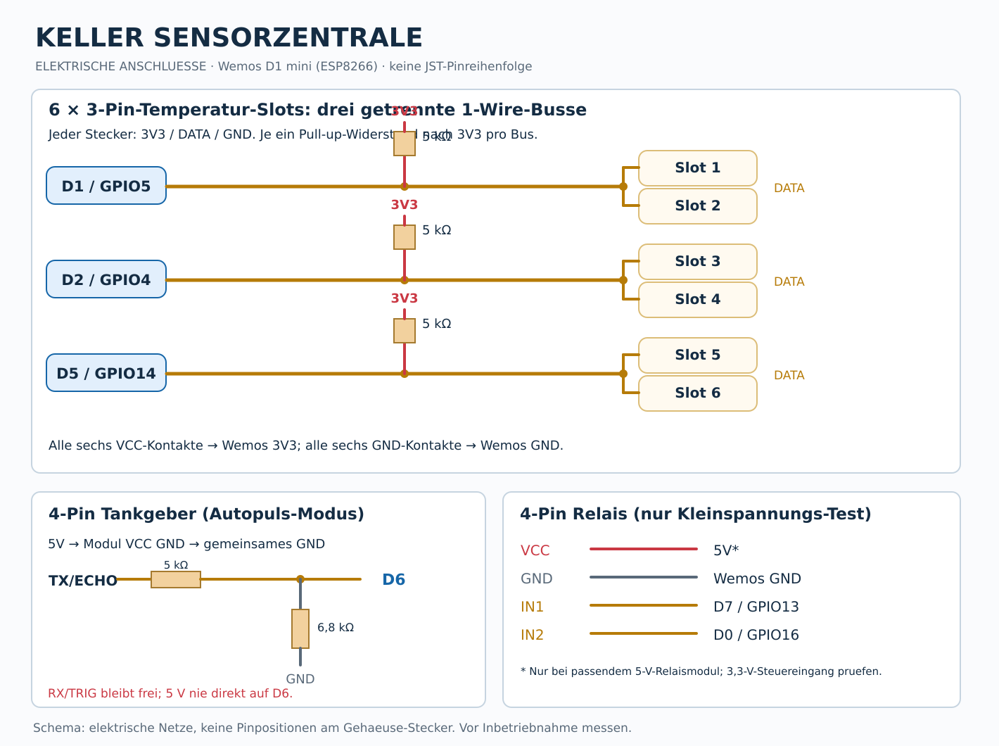
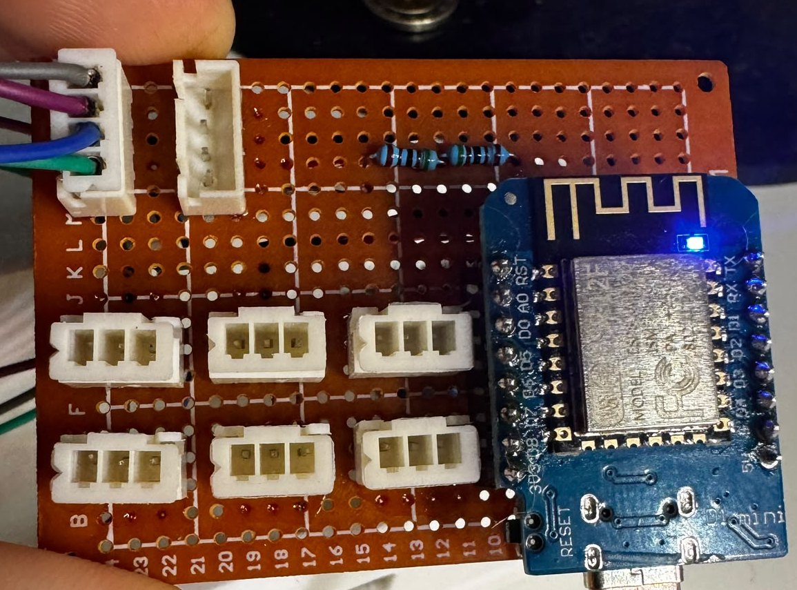
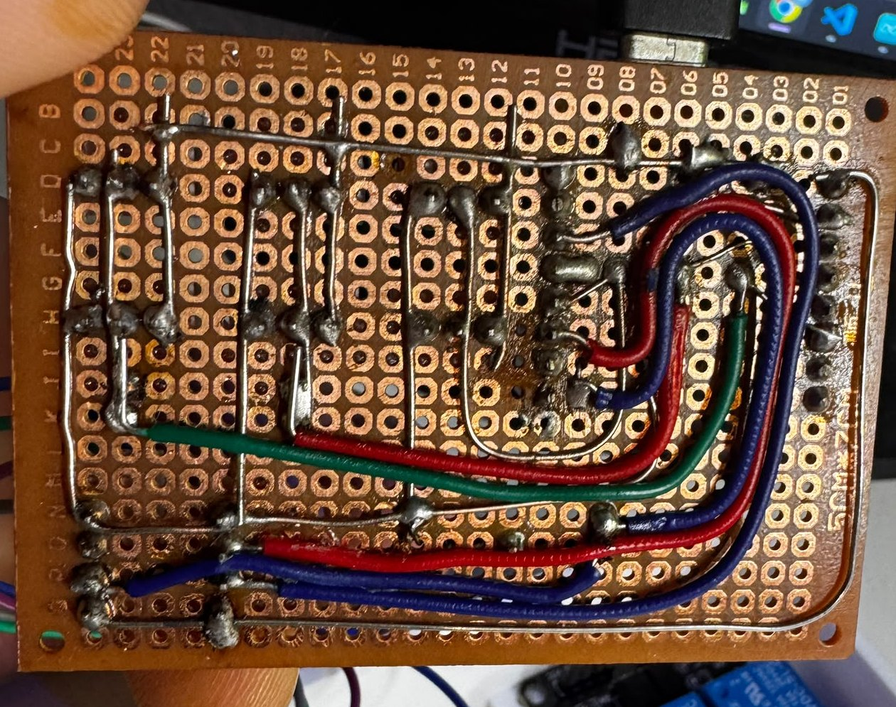

# Bauanleitung der Lochrasterplatine

Diese Anleitung beschreibt den vorhandenen **Prototyp der Keller Sensorzentrale**. Sie ist eine Nachbauhilfe, kein professioneller PCB-Fertigungsplan und keine Zertifizierung. Die Lötseite und eine Bestückungsseite des bisherigen Boards sind unten fotografisch dokumentiert.

*Prototyp: 6 dreipolige Buchsen, 2 vierpolige Buchsen, Wemos D1 mini. Sichtbare Pin-Richtungen sind keine genormten Steckernummern.*

*Lötseite; durch die Kameraperspektive nicht als verbindlicher Leiterbahnplan geeignet.*

## 1. Teile vorbereiten

Siehe [Stückliste](STUECKLISTE.md). Die Lochrasterplatte passend zum geplanten Gehäuse zuschneiden. Wemos am besten auf passenden Buchsenleisten steckbar ausführen; Steckverbinder mechanisch befestigen. Vor dem Löten Platz für die drei DS18B20-Pull-up-Widerstände und die Tank-Pegelanpassung lassen.

## 2. Buchsen beschriften und erst dann verdrahten

- **Sechs 3-Pin-Buchsen:** je 3V3, DATA, GND. Steckplätze 1/2 teilen D1, 3/4 teilen D2 und 5/6 teilen D5.
- **4-Pin Tank:** 5V, GND, TX/ECHO, RX/TRIG (RX im verwendeten Autopuls-Modus unbenutzt).
- **4-Pin Relais:** 5V, GND, IN1, IN2. Nicht mit dem Tankstecker verwechseln.

**Nicht die Reihenfolge der Litzen oder Foto-Farben als Pinout übernehmen.** Je nach Ansicht (Steckerfront vs. Lötseite) ist links/rechts spiegelverkehrt. Vor dem Anschließen mit Datenblatt und Durchgangstest prüfen.

## 3. Gemeinsame Versorgungsleitungen

Wemos **3V3** an VCC aller **3-Pin-Stecker**. Wemos **GND** an GND aller sechs Sensorstecker und der beiden 4-Pin-Verbindungen. Für die 4-Pin-Buchsen die vom Modul verlangte 5-V-Versorgung separat verteilen. 5V und 3V3 sind **unterschiedliche Netze** und dürfen nicht direkt verbunden werden. USB-/Versorgungs- und Relaisstrombelastung separat anhand der verwendeten Module dimensionieren.

## 4. Drei Datenbusse und Pull-ups

- D1 → DATA von Slot 1 und 2; 5-kΩ-Pull-up von D1 nach 3V3.
- D2 → DATA von Slot 3 und 4; 5-kΩ-Pull-up von D2 nach 3V3.
- D5 → DATA von Slot 5 und 6; 5-kΩ-Pull-up von D5 nach 3V3.

**Der Pull-up liegt parallel zwischen 3V3 und Bus-DATA**, niemals als Serienwiderstand auf dem Weg zum DS18B20. Bewährt: Widerstände nahe beim Wemos, gut erreichbar auf freier Lochrasterfläche.

## 5. Tanksignal nur mit Pegelanpassung

Vorhandene Firmware lauscht an **D6/GPIO12** auf automatisch ausgegebene Impulse der konkreten SR04M-2-Variante. Prüfe zunächst, welchen Pegel und welches Signalformat das tatsächliche Modul ausgibt. Falls es 5-V-ECHO-Pulse liefert, siehe [empfohlenen 2-Widerstands-Spannungsteiler](ANSCHLUSSPLAN.md) (5 kΩ + 6,8 kΩ). **Nicht direkt 5 V an D6 anlegen.** Die getestete Prototyp-Anordnung mit 3 × 5 kΩ ist ohne garantierte Spannungsreserve, daher nicht der empfohlene Nachbau.

Ein kommerzielles, zum Sensor passendes 3,3-V-fähiges Pegelwandler-Modul ist eine Alternative. Ob eine Anwendung am bzw. im Heizöltank zulässig ist, muss unabhängig von diesem Elektronikaufbau anhand der Zulassungen geklärt werden.

## 6. Relaisanschluss

D7 zu IN1 und D0 zu IN2, 5V/GND zur dafür geeigneten Relaisplatine. Vorher die tatsächliche active-LOW-Ansteuerung und 3,3-V-Kompatibilität prüfen. Test zunächst **ohne angeschlossene Last**, niemals an Netzspannung oder sicherheitsrelevanten Heizungsfunktionen arbeiten.

## 7. Prüfprotokoll

1. **Strom aus:** Alle sechs GND-Kontakte haben Durchgang zu Wemos GND; DATA-Busse haben **keinen Kurzschluss** zu GND/3V3 und keine gegenseitige Verbindung (Widerstandspfade berücksichtigen).
2. **Strom aus:** Zwischen 3V3 und GND keine nahezu 0-Ω-Verbindung, ebenso 5V gegen GND.
3. **Wemos USB, keine Sensoren:** Versorgung an allen 3-Pin-Buchsen gegen GND ≈3,3 V; an 4-Pin-Buchsen gemäß Spezifikation, nie VCC der DS18B20-Buchsen mit 5 V.
4. **Temperatur-Test:** Sensor an einen Slot pro Bus anschließen, in der Weboberfläche nach Bus scannen und ROM einem logischen Slot zuweisen. Zwei Buchsen am selben Bus lassen sich nur über ROM zuordnen.
5. **Relais-Test:** Mit isoliertem Niederspannungsaufbau die beiden Ausgänge einzeln prüfen. Nach Neustart müssen beide AUS sein.
6. **MQTT-Test:** Im HA-Entwicklerwerkzeug Werte und Relais prüfen; lokale Website ist nur für Konfiguration/Diagnose nötig.
7. **Tank-Test:** Gültige Abstände gegen reales Maß prüfen; Literkennlinie und mechanische Tankanzeigen gegenprüfen. **Verbrauchszähler erst nach erfolgreicher Kalibrierung einschalten.**

## 8. Gehäuse

Montagehöhe, Kabeleinführungen, Standoff-Positionen und USB-Zugänglichkeit richten sich nach der finalen 3MF/STL. Darauf warten wir noch; bis dahin ist diese Anleitung bewusst keine verbindliche Bohr- oder Befestigungsschablone. Siehe [Gehäuse](../../enclosure/README.md).
